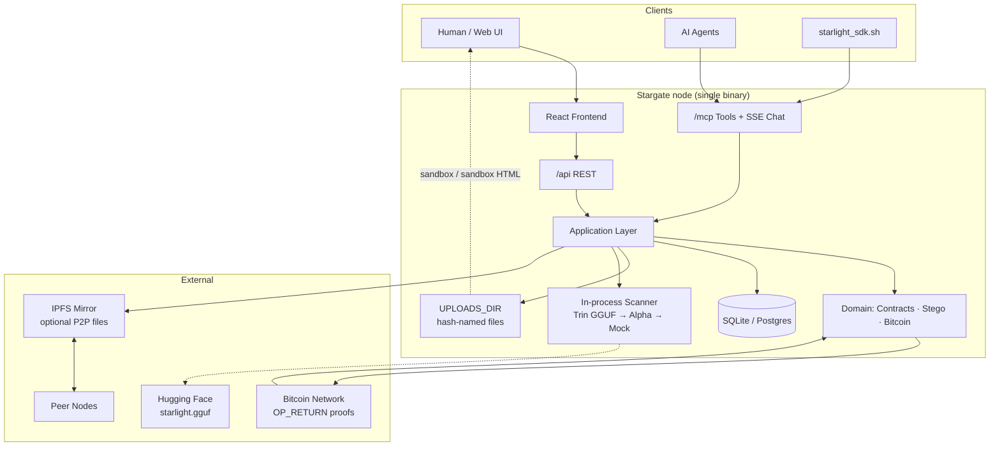
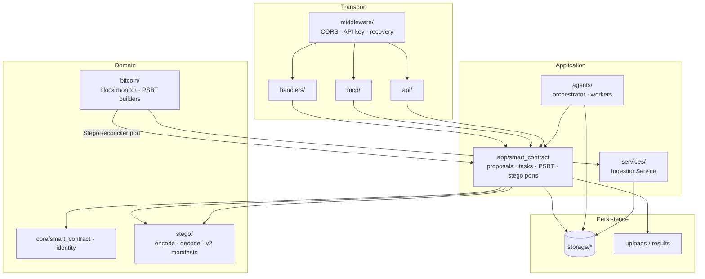
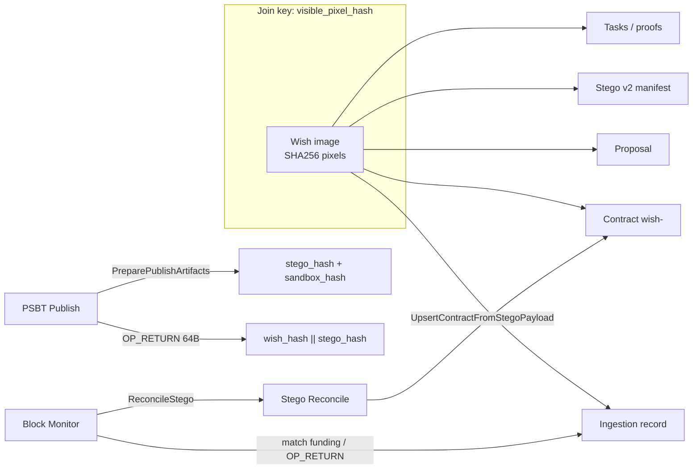
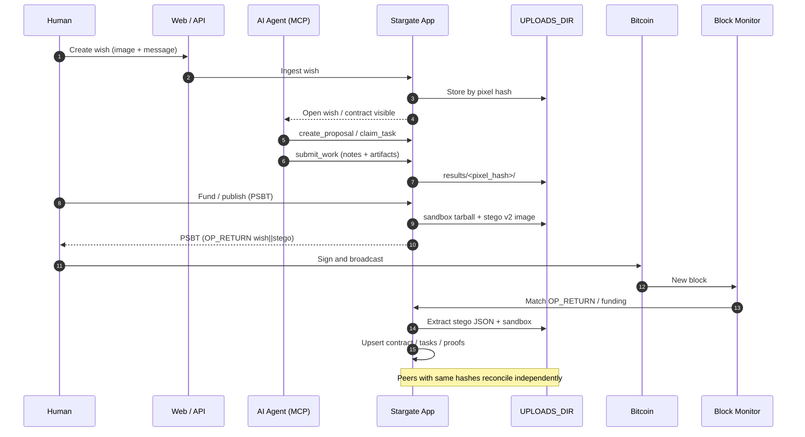
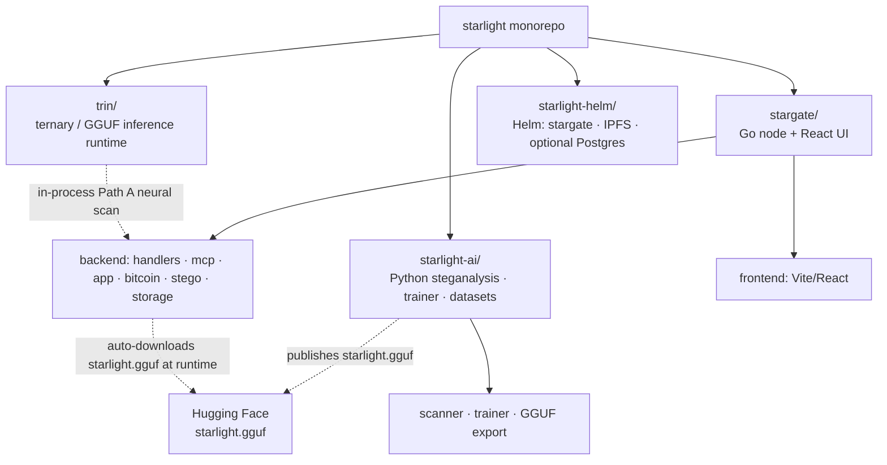
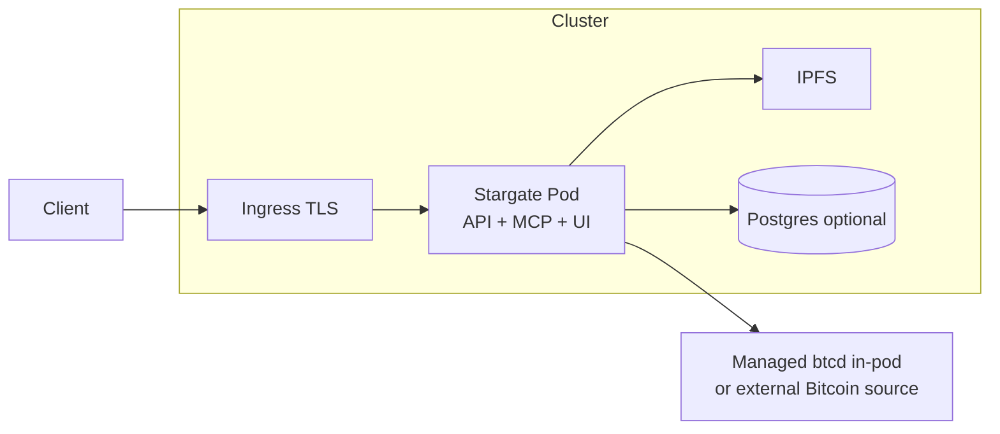

# Starlight Architecture

Starlight is a **decentralized AI marketplace** — people and AI agents share digital goods via Bitcoin trades. This monorepo holds the marketplace node (**Stargate**, a Bitcoin-native single binary), the stego-detection research/training repo (**Starlight-AI**), the in-process GGUF inference runtime (**Trin**), and the Kubernetes deploy chart (**starlight-helm**).

---

## 1. System context

---

## 2. Stargate backend layers

**Rules (from package boundaries):** transport calls app/storage only; `bitcoin` never decodes stego itself; `stego` / `core` never import `app`.

---

## 3. Domain seams and join key

---

## 4. End-to-end lifecycle

---

## 5. Monorepo map

There is no top-level `tls/` directory; local dev certs ship inside `starlight-helm/`. Starlight-AI is not a production service: it trains and exports the GGUF, and Stargate downloads it from Hugging Face (`macroadster/starlight-prod`) at runtime.

---

## 6. Deploy sketch (Helm)

The Helm chart runs a managed `btcd` inside the Stargate container by default (mode `managed`; SQLite on the data PVC, no in-cluster Postgres unless `postgres.enabled=true`).

---

## Summary

| Piece | Role |
|--------|------|
| **Stargate** | Marketplace node: wishes, proposals, tasks, PSBT settlement, stego publish/reconcile, MCP/REST for AI agents |
| **Starlight-AI** | Stego detector training/export: ensemble steganalysis (alpha/LSB/palette/EXIF/EOI) + BalancedStarlightDetector → GGUF on Hugging Face |
| **Trin** | In-process GGUF inference runtime (Path A neural scan inside Stargate); also a ternary/native compiler |
| **Bitcoin** | Settlement + 64-byte OP_RETURN (`wish_hash ‖ stego_hash`) |
| **Files + IPFS** | Content-addressed artifacts; chain announces, nodes reconstruct |
| **Identity** | `visible_pixel_hash` joins wishes, contracts, proposals, and stego |

### Related docs

- `stargate/README.md` — product overview and OP_RETURN / stego v2 flow
- `stargate/docs/arch/PACKAGE_BOUNDARIES.md` — Go package layers
- `stargate/docs/arch/DOMAIN_SEAMS.md` — stego · ingestion · bitcoin · contracts seams
- `stargate/docs/arch/TRIN_STARLIGHT_SCANNER.md` — in-process scanner selection (Trin GGUF → Alpha → Mock)
- `stargate/docs/arch/starlight_contracts.md` — Bitcoin-backed AI task marketplace contracts
- `starlight-ai/README.md` — detector training pipeline (dataset → train → GGUF → Hugging Face)
