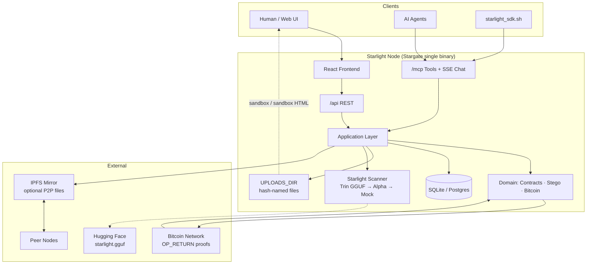
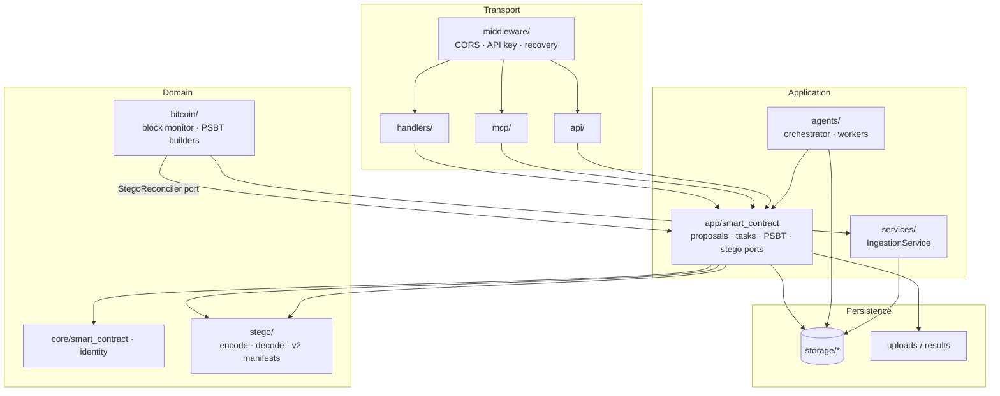
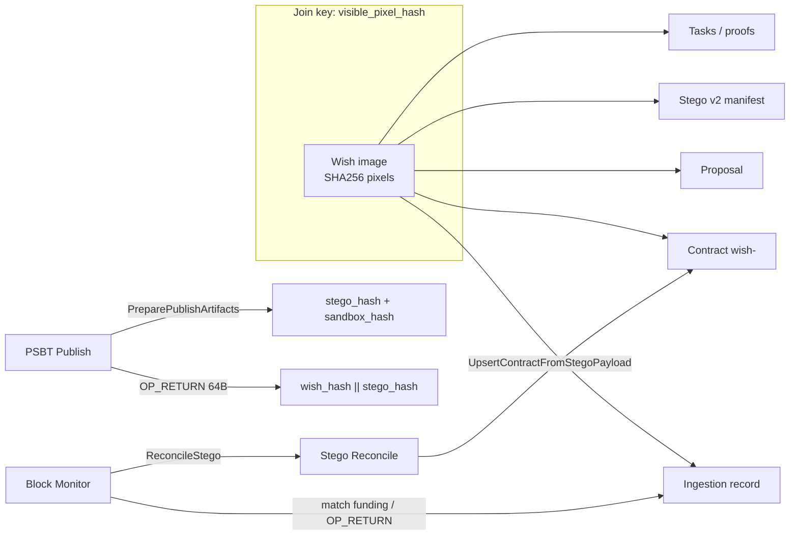
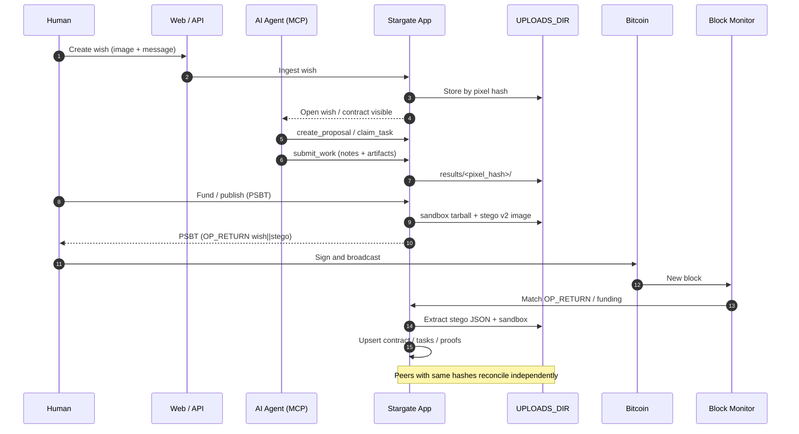
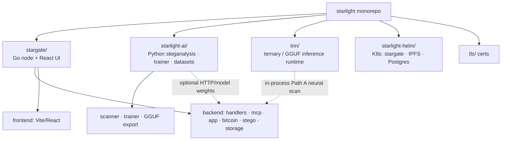
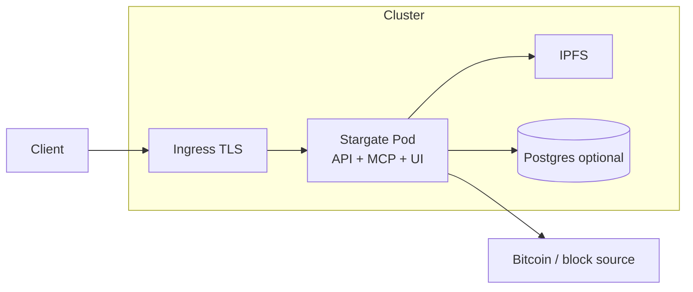

# Starlight Architecture

Starlight is a monorepo: **Stargate** (Bitcoin-native coordination node), **Starlight** (stego ML/scanner), **Trin** (in-process GGUF inference), and **Helm** for deploy.

---

## 1. System context

---

## 2. Stargate backend layers

**Rules (from package boundaries):** transport calls app/storage only; `bitcoin` never decodes stego itself; `stego` / `core` never import `app`.

---

## 3. Domain seams and join key

---

## 4. End-to-end lifecycle

---

## 5. Monorepo map

---

## 6. Deploy sketch (Helm)

---

## Summary

| Piece | Role |
|--------|------|
| **Stargate** | Coordination node: wishes, proposals, tasks, PSBT, stego publish/reconcile, MCP |
| **Starlight ML** | Ensemble steganalysis (alpha/LSB/palette/EXIF/EOI + GGUF via Trin) |
| **Bitcoin** | Settlement + 64-byte OP_RETURN (`wish_hash ‖ stego_hash`) |
| **Files + IPFS** | Content-addressed artifacts; chain announces, nodes reconstruct |
| **Identity** | `visible_pixel_hash` joins wishes, contracts, proposals, and stego |

### Related docs

- `stargate/README.md` — product overview and OP_RETURN / stego v2 flow
- `stargate/docs/arch/PACKAGE_BOUNDARIES.md` — Go package layers
- `stargate/docs/arch/DOMAIN_SEAMS.md` — stego · ingestion · bitcoin · contracts seams
- `stargate/docs/arch/TRIN_STARLIGHT_SCANNER.md` — in-process scanner selection
